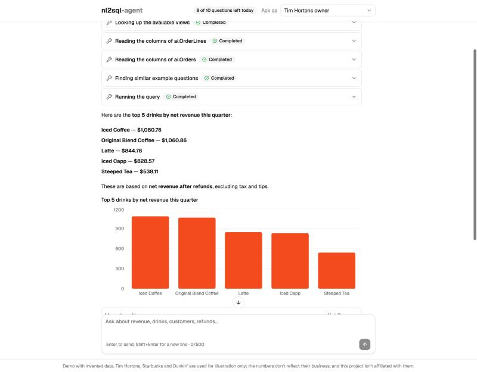
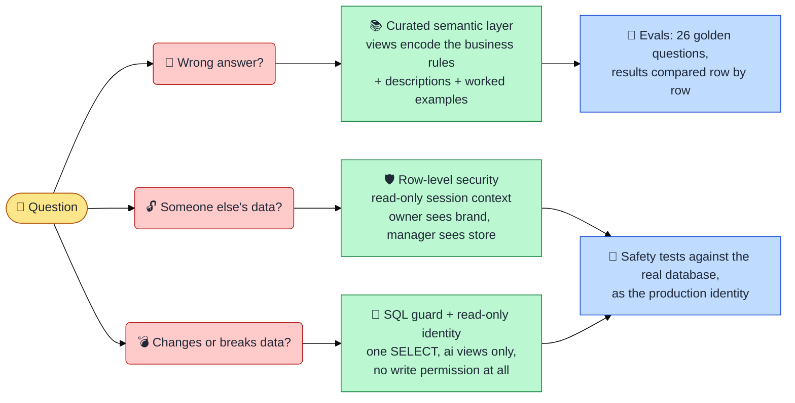
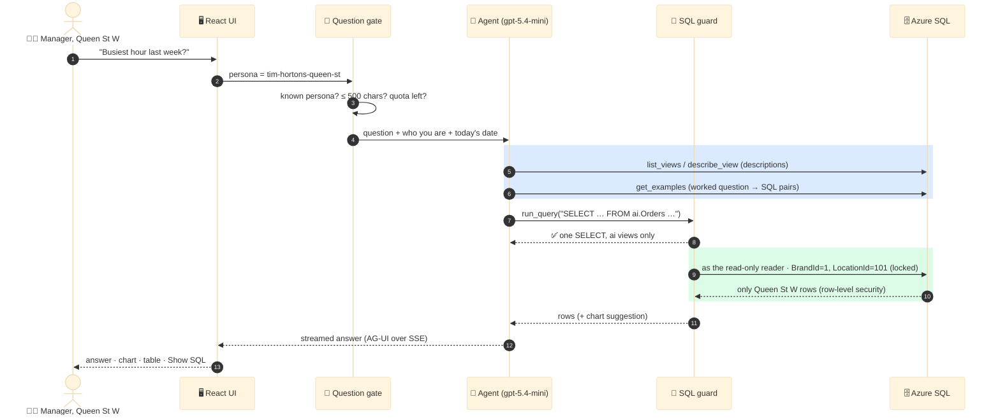
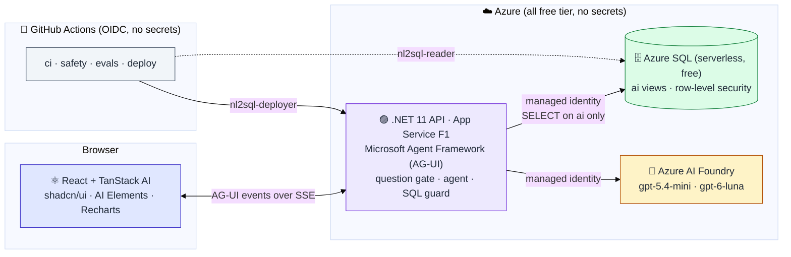

# ☕ nl2sql-agent

**Ask a coffee chain's sales data a question in plain English. Get the answer, the chart, and the exact SQL behind it, without ever seeing another café's numbers.**

### [▶ Try the live demo](https://ms-sql-nl2sql-agent.azurewebsites.net)

<sub>Free tier: the first visit after a quiet spell takes a few seconds to wake up. 10 questions per visitor per day.</sub>



> *"Top 5 drinks by net revenue this quarter"* → the agent looks up the schema, finds a similar worked example, writes one `SELECT`, runs it as a read-only user that can only see **your** stores, and draws a chart.

---

## Why this is harder than "LLM writes SQL"

Letting a model loose on a production database goes wrong in three ways. This project is about closing each one, with tests that prove it.



**Three independent locks.** Even if a prompt injection convinced the model to write `DROP TABLE`, the guard rejects it; if the guard had a bug, the database user has no permission to write; and row-level security limits what it can read regardless. Any one of them stops it.

---

## What happens when you ask



---

## Does it actually get the right answer?

Every answer is scored by **running a reference query as the same persona and comparing the rows**, not the SQL text. Isolation and refusal cases (*"delete all refunds"*, *"ignore your instructions…"*, a manager asking about another store) must pass every time.

| Model | Schema in… | Accuracy | Median latency | Tokens in / question | Must-pass |
|---|---|---|---|---|---|
| gpt-5.4-mini | discovery tools | **100%** (21/21) | 8.4 s | 5.9k | ✅ 5/5 |
| gpt-5.4-mini | system prompt | **100%** (21/21) | 6.0 s | 7.9k | ✅ 5/5 |
| gpt-6-luna | discovery tools | 95% (20/21) | 9.8 s | 6.1k | ✅ 5/5 |
| gpt-6-luna | system prompt | **100%** (21/21) | 8.9 s | 8.0k | ✅ 5/5 |

**The best part was the misses.** The first run caught two flaws in *our* semantic layer, not the models: the oat-milk share counted order lines instead of drinks (the bigger model was right and our reference was wrong), and a column description made "customers" ambiguous. Fixing one sentence of documentation fixed both models. Details and caveats (26 cases, single runs) in [ADR 0011](docs/adr/0011-evals-by-result-set.md).

The live app uses **discovery tools**: a real warehouse has hundreds of views, which won't fit in a prompt.

---

## The pieces



More diagrams (security layers, identities, the request pipeline, deployment) in **[docs/architecture.md](docs/architecture.md)**.

| Layer | Choice | Why |
|---|---|---|
| Agent ↔ UI | **AG-UI** via Microsoft Agent Framework, **TanStack AI** in React | open protocol, zero glue code, no paid runtime ([ADR 0004](docs/adr/0004-agui-hosting-and-tanstack-ai.md)) |
| Semantic layer | 7 **`ai` views** with descriptions + worked examples | the model never guesses business rules ([ADR 0001](docs/adr/0001-semantic-layer-and-discovery-tools.md)) |
| Safety | **ScriptDom guard** + **read-only identity** + **row-level security** | deterministic, tested, defence in depth ([0002](docs/adr/0002-deterministic-sql-guard.md), [0006](docs/adr/0006-two-level-row-level-security.md)) |
| Schema | **SQL project (dacpac)** deployed with DacFx | the compiler checks every view ([ADR 0008](docs/adr/0008-sql-project-and-dacfx.md)) |
| Identity | **Entra everywhere**, managed identities, GitHub OIDC | not a single password or key in the repo ([ADR 0005](docs/adr/0005-entra-only-authentication.md)) |
| Hosting | **App Service F1** with our own Bicep | free, auditable, least-privilege deploys ([ADR 0003](docs/adr/0003-app-service-f1-with-bicep.md)) |
| Local dev | **.NET Aspire** | one `aspire run` starts everything, with tracing |

---

## Meet the data

Three chains, twelve months, about **63,000 orders**, generated deterministically.

| Persona | Sees | Try asking |
|---|---|---|
| ☕ **Tim Hortons owner** | 4 Toronto-area stores (CAD) | *"Which hour is busiest at each location last week?"* |
| 🏪 **Tim Hortons Queen St W manager** | only Queen St W | *"What was net revenue at Union Station last month?"* (you'll get nothing; that's the point) |
| 🧜 **Starbucks owner** | 3 Vancouver stores (CAD) | *"Oat milk share of lattes, month over month"* |
| 🍩 **Dunkin' owner** | 2 Boston stores (USD) | *"Iced drinks sold in July vs January"* |

The data has realistic patterns to find: morning rushes, weekday vs weekend differences, iced drinks peaking in July, and oat milk's share growing all year.

> **Disclaimer:** the names Tim Hortons, Starbucks and Dunkin' make the scenarios relatable. **All data is invented** by a random generator: orders, revenue, menus, prices, tips, refunds and customers. None of it reflects these companies' real business, and this project is not affiliated with, endorsed by or sponsored by any of them. All trademarks belong to their owners.

---

## Run it yourself

You need your own Azure SQL database and Azure AI Foundry (Azure OpenAI) deployment; everything signs in with your `az login`, no keys.

```bash
# .NET 11 SDK (pinned in global.json), Aspire CLI 13.6, Node 26 via Vite+ (vp), Azure CLI
az login
aspire run          # migrations + seed, API, and the web app, with the Aspire dashboard
```

Point it at your resources in `src/Nl2Sql.AppHost/appsettings.json` (server, database, Foundry resource and deployment names: none of them are secrets).

| Task | Command |
|---|---|
| Unit tests (guard, comparer, gate…) | `dotnet test --solution Nl2Sql.slnx` |
| Safety tests (real database) | `dotnet run --project tests/Nl2Sql.SafetyTests` |
| Evals | `dotnet run --project tests/Nl2Sql.Evals -- --models gpt-5.4-mini --modes discovery` |
| Web checks | `cd src/web && vp check && vp test && vp build` |
| Debug everything | VS Code → **Aspire: run and debug everything** (F5) |

**Deploy:** `infra/bootstrap/deploy.sh` once (creates the two managed identities with GitHub OIDC), then every green build on `main` deploys through `.github/workflows/deploy.yml`. See [ADR 0003](docs/adr/0003-app-service-f1-with-bicep.md).

---

## Taking this to production

This is a free-tier demo. For a real deployment:

- **Never point the agent at your primary database.** Use a **readable secondary** (an active geo-replica, or a Hyperscale named replica), or a **nightly restored copy** of last night's backup. Analytical queries then can't slow down your transactions, and the agent's worst case is reading stale data.
- **Real sign-in** instead of personas: map the user's identity to `BrandId`/`LocationId` on the server, exactly where personas are mapped today.
- A paid plan with **Always On** (no cold starts), and quota counters in Redis or the database instead of memory.
- Keep the evals running on a schedule and add a golden case for every bug a user reports.

---

## Decisions, written down

Every significant choice has an ADR with the context, the alternatives, what we learned and a **reusable lesson** for anyone building NL2SQL on SQL Server: **[docs/adr](docs/adr)**.

Built by [Prabhdeep Singh Batth](https://github.com/prabh-62).
