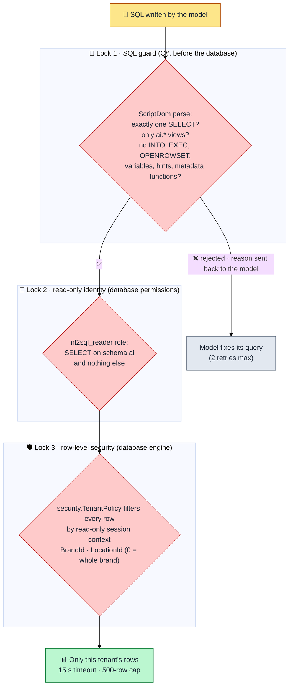
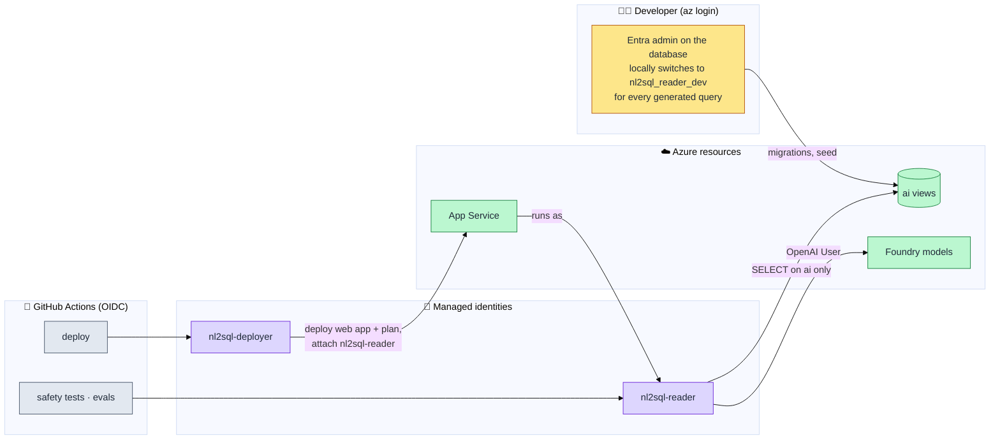
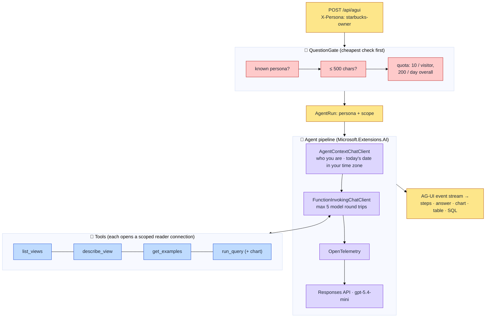
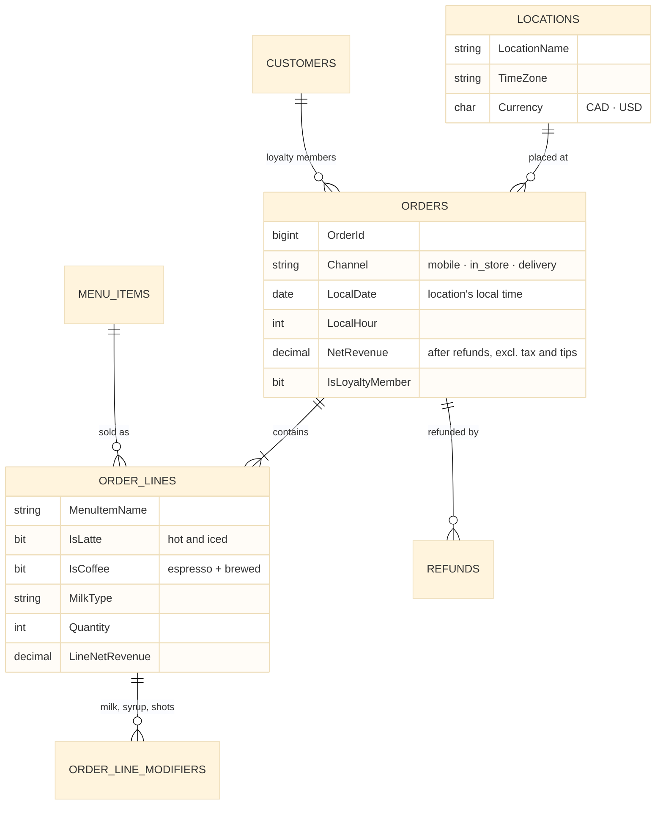
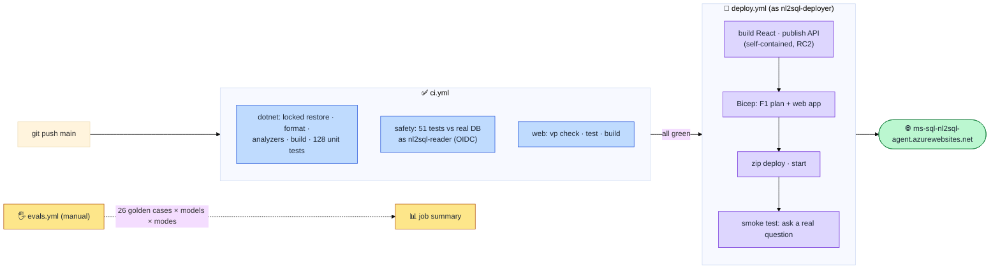

# Architecture

The [README](../README.md) has the overview. This page goes one level deeper. Each diagram links to the decision record that explains it.

---

## 1. Three locks on every query

Model-generated SQL has to get past three independent checks. Each would stop a harmful query on its own. ([ADR 0002](adr/0002-deterministic-sql-guard.md), [ADR 0006](adr/0006-two-level-row-level-security.md))

Tested by `tests/Nl2Sql.UnitTests/SqlGuardTests.cs` (81 evasion attempts) and `tests/Nl2Sql.SafetyTests` (51 tests against the real database, signed in as the production identity).

---

## 2. Who can do what

No passwords or keys exist anywhere: everything signs in with Microsoft Entra ID. ([ADR 0005](adr/0005-entra-only-authentication.md), [ADR 0003](adr/0003-app-service-f1-with-bicep.md))

The deployer can't read data or touch the SQL server or Foundry; the reader can't change anything.

---

## 3. Inside one question

A question passes the gate, then the agent's chat-client pipeline, where each layer adds one concern. ([ADR 0009](adr/0009-personas-and-demo-limits.md))

---

## 4. The semantic layer

The model only ever sees the `ai` views. Each encodes business rules so the model never guesses them, and every column has a description stored in the database. ([ADR 0001](adr/0001-semantic-layer-and-discovery-tools.md))

Voided and cancelled orders are already excluded, and the same views carry row-level security from the base tables beneath them.

---

## 5. From commit to live site

Database schema changes (the dacpac and seed) are deliberately applied from a developer's machine, not from CI: the database is shared and free-tier, and schema changes are rare.
